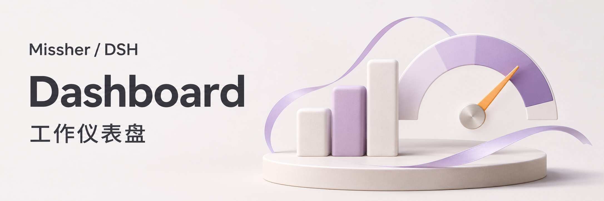
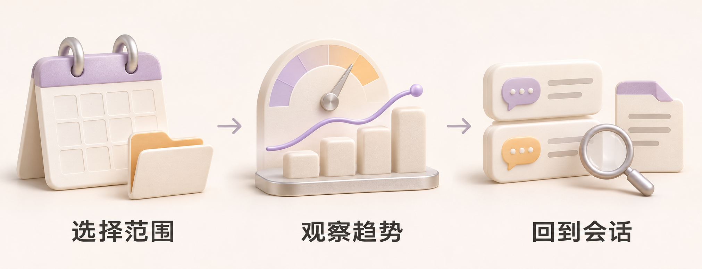
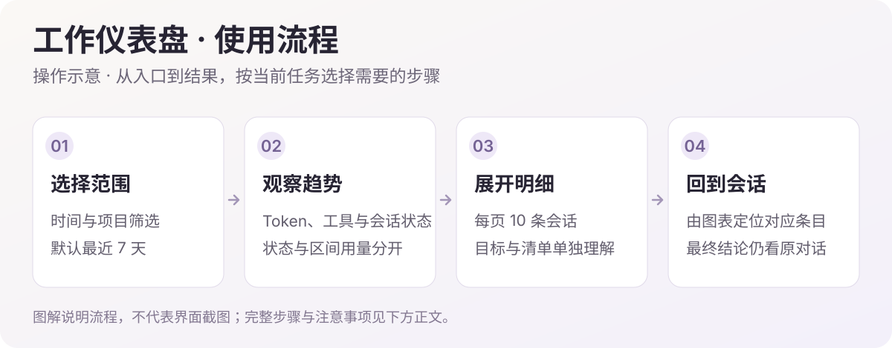

# DSH 工作仪表盘

当前版本 **0.3.3** · [下载 Release 安装包](https://github.com/Missher12/Missher-DSH-Dashboard/releases/tag/v0.3.3)

在 DeepSeek Harness 侧栏查看会话状态、Token 趋势、目标与清单进度，以及 Superagent 任务概览。

| 查看什么 | 内容 |
| --- | --- |
| 普通会话 | 状态、筛选、每页 10 条明细与原会话入口 |
| 图表视图 | Token 趋势、会话状态、Token 构成、工具调用、活跃会话、53 周 Token 颗粒图和今日小时柱图、用量分布、清单进度与排行 |
| 本地缓存 | 重启先显示已有统计，标明时间并在后台更新 |
| 目标和清单 | 明确记录的完成状态及条目进度 |
| Superagent | 工作中、需要关注、任务完成、Token 消耗四张概览卡片 |

使用统计沿用自有插件的五项摘要、每日／每周／累计切换与配色，跟随普通项目和归档筛选。统计通过宿主会话服务读取，不发起模型请求。后台更新保留筛选、页码、图例开关和已有列表顺序，整轮汇总后更新图表；空闲蓝色、工作中绿色、需关注红色。面板可见时每 5 秒刷新。图为功能示意，实际统计口径与宿主兼容范围见项目原说明。

## 快速开始

1. 从 [v0.3.3 Release](https://github.com/Missher12/Missher-DSH-Dashboard/releases/tag/v0.3.3) 下载 `.tgz` 安装包。
2. 在 DSH 插件管理页更新或安装 `@missher/dsh-dashboard` 并启用，按宿主提示重新加载。
3. 从侧栏打开“工作仪表盘”，选择时间范围和项目。源码构建方法见[项目说明](../README.md)。

源码下载、已构建安装包和应用当前加载版本分别记录；本仓库不包含个人会话、配置或统计数据。

<!-- visual-guide -->

## 图解使用流程

从整体趋势找到需要关注的会话，再回到原始对话确认。

场景插画：帮助理解用途与操作顺序，不是 DSH 界面截图。

[查看完整流程图](../docs/images/workflow-guide.svg)

| 步骤 | 怎样操作 | 需要留意 |
| --- | --- | --- |
| 1. 选时间和项目 | 先确定要观察的时间段及项目，默认展示最近 7 天。 | 比较图表前保持范围一致，避免把当前状态当作整个时段的状态。 |
| 2. 观察活动与用量 | 查看 Token 趋势、构成、会话状态、工具趋势、活跃趋势、53 周 Token 颗粒图和今日小时柱图、分布、清单进度和排行。 | 只统计有效记录；继承的历史不重复计入，缺少数据不会补造。 |
| 3. 查看明细 | 从图表条目定位对应会话行，再查看每页 10 条的列表。 | 清单比例按条目计算，不是工时或工作量的百分比。 |
| 4. 核对原会话 | 进入原始会话，确认目标是否完成、是否仍有待处理事项。 | 回合结束或暂时空闲不能单独证明任务完成。 |

### 试一次

> 查看最近 7 天当前项目的活动，先找需要关注的会话，再从 Token 排行定位消耗较多的一项，打开原会话核对原因和剩余工作。

使用后可以这样核对：

- 时间范围、项目筛选与想比较的对象一致。
- 普通会话统计和 Superagent 四张概览卡片分别理解。
- 回到原会话确认目标和交付；不从一张绿色卡片推断全部工作完成。

### 设置怎么选

| 项目 | 建议 |
| --- | --- |
| 时间与项目 | 先设范围，再读趋势；当前状态与时段统计采用各自口径。 |
| 后台刷新 | 面板可见时每 5 秒更新，保留已有结果和交互状态，避免刷新打乱阅读。 |
| 本地缓存 | 重启先显示已有统计并标明时间，再后台更新；缓存不是额外的会话副本。 |

仪表盘读取宿主记录，不为统计调用模型。缺少计价配置时不提供推测账单；颜色帮助定位状态，具体任务结论仍需查看原始会话。
<!-- /visual-guide -->

<!-- readme-expansion -->
## 使用场景

| 遇到的情况 | 怎样使用 |
| --- | --- |
| 想快速知道哪些会话还在工作、哪些需要关注 | 查看当前状态、目标、任务清单和可跳转的会话明细。 |
| 想从项目角度观察 Token 和工具调用变化 | 使用时间范围与项目筛选，查看图表视图和排行。 |
| 重启 DSH 后希望立即看到上次统计 | 先显示本地缓存及更新时间，再在后台更新真实记录。 |

## 常见问题

刚打开时为什么显示上次结果？

0.3.3 会保存派生统计，重启先展示缓存及其时间，再后台重新读取记录。页面会区分缓存与更新状态；缓存损坏或不适用时重新汇总。

打开页面会发起模型请求或计算账单吗？

统计不发起模型请求。它汇总已记录的有效用量；没有精确计费配置时不推算金额，不能把 Token 图表直接当作供应商账单。

清单 100% 就能证明工作全部完成吗？

条目比值不等于工作量百分比，也不是发布或验收结论。目标完成仅依据明确目标／任务记录，空闲或一轮回复结束不自动算完成。

## 搭配使用

[使用统计](https://github.com/Missher12/Missher-DSH-Usage-Statistics) 侧重长期活动习惯；[Superagent](https://github.com/Missher12/Missher-DSH-Superagent) 管理任务本身。仪表盘负责从已有数据观察工作情况，不替代派单。

## 升级与数据

统计缓存保存在当前宿主配置目录，与原始会话分开。升级沿用已有会话和插件实例；停用或重新统计不应通过清空个人会话来完成。
<!-- /readme-expansion -->

[详细说明](../README.md) · [许可](../LICENSE) · [第三方声明](../THIRD_PARTY_NOTICES.md)
