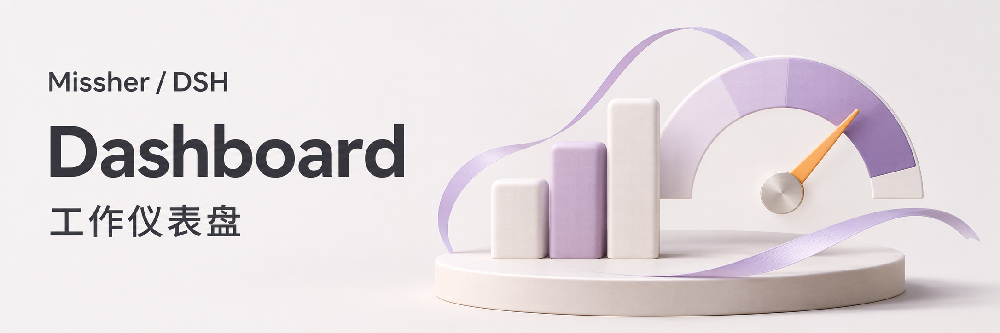

# DSH 工作仪表盘



`@missher/dsh-dashboard` 0.4.5，开发 SDK 为 DeepSeek Harness 0.2.1-rc.4。安装后从侧栏「工作仪表盘」打开，默认显示近 7 天。

页面与宿主原生插件页对齐：内容列最大 960px 并居中，左右留白为 24–48px，窄窗口为 20px；macOS 顶部沿用宿主安全区并增加 28px 内容间距。标题为 20px，滚动条位于页面外侧。

插件速览沿用已保存的插件选择。Memory 和 MSE 在统计可读时显示条目数量，其他插件显示版本和实际加载状态。布局保存在当前 DSH 配置目录下的 `.dsh-dashboard/layout-v1.json`，重启后恢复。

界面采用「云白」样式。顶部的 Liquid Glass 工具栏集中显示项目、归档、时间范围和刷新。项目和颗粒配色使用贴着控件展开的原生下拉列表。透明工具栏在边缘呈现轻微折光，页面底色跟随 DSH。概况区显示工作中、目标完成、需要关注和输入缓存命中率；左侧蓝色曲线展示所选 Token 构成的有效用量之和，右侧显示当前范围内的四条最近会话，可点击打开原会话。项目筛选位于页首，今天、近 7 天、近 30 天控制概况、趋势和最近会话。曲线经过真实采样点，平滑处不产生额外峰值，支持点击和悬停查看精确用量；大数按中文万、亿及英文 K、M、B 显示。

「使用统计」沿用自有使用统计插件的口径，以横向布局展示五项历史摘要、最近 53 周的每日／每周／累计颗粒图，以及今天 24 小时用量。颗粒图每列固定 7 个点，切换口径时保持相同高度。宽窗口下，Token 活动和小时活动的标题、绘图区和刻度对齐，小时明细可在图上查看。此区域跟随普通会话的项目和归档选择，保留全部历史，不受首页短期范围截断。沿用配色选择；无自定义色时使用云白主题的蓝色。仅统计有效供应方记录，不把工具活动推算成 Token。缺失记录留空，已报告的零显示为 0。连续天数按本人发消息的日期计算，最长会话仅累计已结束轮次的工作时长。

仪表盘可单独安装。启用 SuperAgent 且任务数据可读取时，图表下方显示工作中、需要关注、目标完成和已记录 Token 四张概览卡。普通会话的统计和缓存独立更新。空闲为蓝色，工作中与完成为绿色，需处理状态为红色。浅深色主题跟随宿主。

点击最近会话可打开原会话。SuperAgent 摘要汇总全部项目，共用时间范围与归档开关。面板可见时在每轮汇总结束后间隔约 5 秒更新。点「刷新」可立即更新，已有汇总时等待本轮结束。

统计使用宿主会话服务和供应商返回的用量，不发起模型请求。仅汇总有效用量记录，缺失或无效的记录直接跳过；界面统一标为「已记录 Token」，不显示缺失用量警告或星号。派生会话的继承历史不重复统计。目标完成只取明确目标／任务记录，空闲和一轮回复结束不算完成。清单比值是条目数，不是工作量百分比。状态是当前状态，用量属于选定时间范围；目标／清单仅统计当前所属会话中最新的记录。无精确计费配置时不推算金额。

初次读取历史记录期间按 250ms 间隔获取进度并逐批显示，汇总完成后恢复 5 秒刷新。重新打开页面或切换到已读时间范围时先显示内存中的结果，再更新；新范围尚未返回时保留原图并显示加载状态。

已有完整结果时，后台汇总期间保留原图，整轮完成后更新数据，避免中间批次反复改变图表。刷新保留项目、时间范围、归档选择、图例开关与已有会话顺序，新会话追加到末尾。图表及更新提示预留稳定高度。

完整读取后，派生统计自动保存到当前宿主配置目录下的 `.dsh-dashboard/cache-v1.json`。重启后先显示上次统计及其时间，再后台重新读取所有会话，更新变化并移除已删除的记录；旧宿主的会话 revision 不用于跳过新一轮核验。缓存保存小时汇总和本人发消息的日期（不含内容），今天、近 7 天和近 30 天均可直接显示。升级前的缓存仍可显示 Token，尚无日期依据的连续天数在后台核对完成后补齐。仅数据变化时写入，通过临时文件替换完整缓存，读取失败的扫描不覆盖上次成功结果。首次尚无缓存、格式损坏、版本不兼容或时区变化时自动重新汇总；保存失败会在界面提示，但实时统计继续可用。缓存不保存原始消息和工具参数，不改动会话记录。图表使用内嵌 SVG，无外部图表脚本，接口仅允许本机同源读取。

```sh
pnpm install
pnpm run typecheck
pnpm test
pnpm run build
pnpm pack --pack-destination dist
```

在桌面插件管理页添加 `dist/missher-dsh-dashboard-0.4.5.tgz` 并启用。无需为其他插件更新或重新打包。
