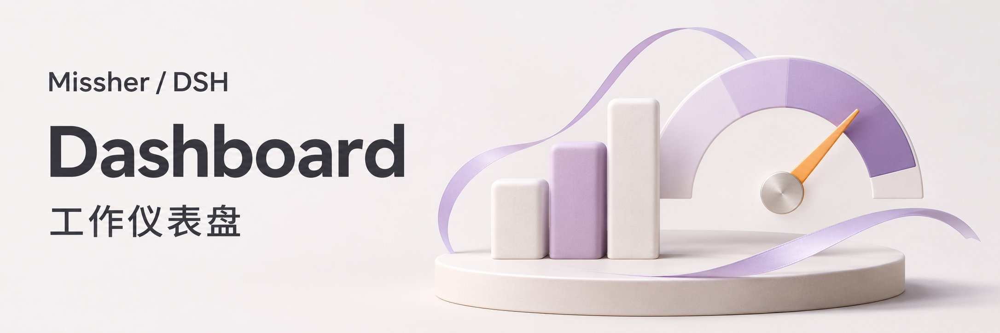

# DSH 工作仪表盘



`@missher/dsh-dashboard` 0.3.3，适配 DeepSeek Harness 0.2.1-rc.4。安装后从侧栏「工作仪表盘」打开，默认显示近 7 天。

顶部汇总当前项目的工作中、需关注、目标完成和清单完成。左侧四张会话卡显示标题、项目、状态与有效 Token 用量，可翻页或点击定位明细。右侧绿色柱图可切换工具调用与活跃会话，第二行用趋势线展示所选 Token 构成之和。

「使用统计」沿用自有[使用统计插件](https://github.com/Missher12/Missher-DSH-Usage-Statistics)的布局：五项摘要、最近 53 周的 Token 颗粒图（每日／每周／累计）和今天 0–23 点的小时活动。颗粒图和小时图共享配色，点击、悬停或使用方向键可查看精确用量。缺失记录不计入，有报告的零显示为 0。累计包含显示窗口之前的已记录用量；连续天数按本人发消息的日期计算，最长会话只累加已结束轮次的工作时长。此区跟随普通会话项目和归档开关，首页的今天／近 7 天／近 30 天用于其他趋势和列表，不截断历史。原使用统计插件无需同时启用。

普通会话、Superagent 卡片和图表沿用宿主画布，无额外灰底。

趋势图使用整刻度并标出峰值。中文大数按万、亿显示，英文按 K、M、B 显示，可查看精确读数。下方保留四张 Superagent 卡片，以及会话状态、Token 构成、会话 Token 分布、任务清单进度和 Token 排行。空闲蓝色、工作中与完成绿色、需关注红色。Token 分布只纳入有有效用量的会话。Superagent 由任务关联及宿主专用预设识别。

普通会话明细固定每页 10 条，可翻页、筛选、展开并打开原会话。翻页保留当前滚动位置和列表高度，末页不足 10 条时分页按钮也不跳动。点击图表中的会话会跳到所在页。用量趋势和任务汇总覆盖所选时间范围，使用统计保留全部历史；这些数据均不受列表页码影响。Superagent 卡片汇总全部项目，共用时间范围与归档开关；不受普通会话筛选和翻页影响。面板可见时每 5 秒刷新。

统计使用宿主会话服务和供应商返回的用量，不发起模型请求。仅汇总有效用量记录，缺失或无效的记录直接跳过；界面统一标为「已记录 Token」，不显示缺失用量警告或星号。派生会话的继承历史不重复统计。目标完成只取明确目标／任务记录，空闲和一轮回复结束不算完成。清单比值是条目数，不是工作量百分比。状态是当前状态，用量属于选定时间范围；目标／清单仅统计当前所属会话中最新的记录。无精确计费配置时不推算金额。

初次读取历史记录期间按 250ms 间隔获取进度并逐批显示，汇总完成后恢复 5 秒刷新。重新打开页面或切换到已读时间范围时先显示内存中的结果，再更新；新范围尚未返回时保留原图并显示加载状态。

已有完整结果时，后台汇总期间保留原图，整轮完成后更新数据，避免中间批次反复改变图表。刷新保留项目、状态、搜索、图例开关、页码与已有会话顺序，新会话追加到末尾；删除导致当前页超出范围时停在最后一页。图表及更新提示预留稳定高度，不添加自动动画。主动更改筛选时回到第一页。

完整读取后，派生统计自动保存到当前宿主配置目录下的 `.dsh-dashboard/cache-v1.json`。重启后先显示上次统计及其时间，再后台重新读取所有会话，更新变化并移除已删除的记录；旧宿主的会话 revision 不用于跳过新一轮核验。缓存保存小时汇总和本人发消息的日期（不含内容），今天、近 7 天和近 30 天均可直接显示。升级前的缓存仍可显示 Token，尚无日期依据的连续天数在后台核对完成后补齐。仅数据变化时写入，通过临时文件替换完整缓存，读取失败的扫描不覆盖上次成功结果。首次尚无缓存、格式损坏、版本不兼容或时区变化时自动重新汇总；保存失败会在界面提示，但实时统计继续可用。缓存不保存原始消息和工具参数，不改动会话记录。图表使用内嵌 SVG，无外部图表脚本，接口仅允许本机同源读取。

图表跳转在结果渲染完成后，仅滚动仪表盘自身的容器，不移动宿主框架。搜索与列表状态筛选保留位置；空结果与末页保留普通列表高度，展开详情的高度不带入下一页。

```sh
pnpm install
pnpm run typecheck
pnpm test
pnpm run build
pnpm pack --pack-destination dist
```

在桌面插件管理页添加 `dist/missher-dsh-dashboard-0.3.3.tgz` 并启用。无需为其他插件更新或重新打包。
